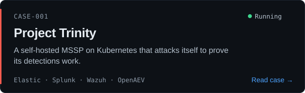
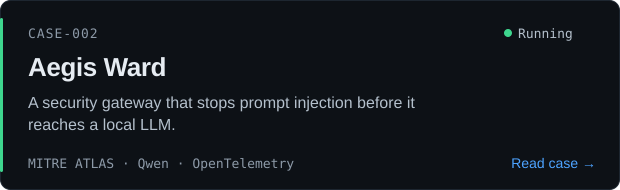
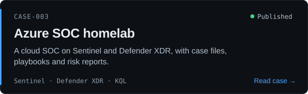
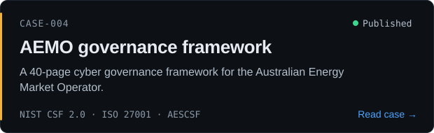
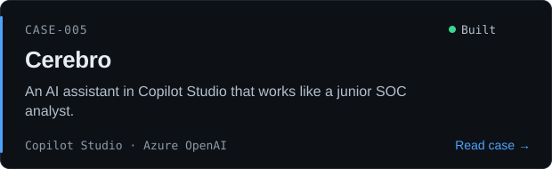
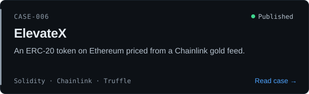

I break my own defences before attackers do, from endpoints to LLMs, and architect systems resilient to dynamic agentic attacks.

- 🛡️ **150+ Elastic Security rules** written, tested and tuned against real attacks
- ⚔️ **Purple teaming** in OpenAEV: attack the detection, keep only what fires
- 🤖 **AI security:** a gateway that stops prompt injection, tested against MITRE ATLAS
- 🏠 **Project Trinity:** a self-hosted SOC with three SIEMs that attacks itself

### Case files

<table>
<tr>
<td width="50%"></td>
<td width="50%"></td>
</tr>
<tr>
<td width="50%"></td>
<td width="50%"></td>
</tr>
<tr>
<td width="50%"></td>
<td width="50%"></td>
</tr>
</table>

### Toolkit

